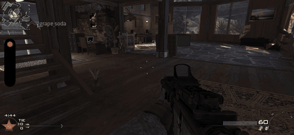

<table align="center">
<tr>
<td align="center" width="50%">

</td>
<td align="center" width="50%">

</td>
</tr>
</table>

  

<h1 align="center">IW4 Pocket</h1>

Modern Warfare 2 (2009) sur votre iPhone, avec le moteur open source IW4L. Non officiel et expérimental.

🌍 <a href="README.md">English</a> · <a href="README.it.md">Italiano</a> · <a href="README.es.md">Español</a> · <b>Français</b> · <a href="README.de.md">Deutsch</a>

## 🎯 C'est quoi ?

Un port sur iOS du moteur open source [IW4L](https://github.com/vladtrc/iw4L). Il **ne contient pas le jeu** : il lit les fichiers du jeu **que vous possédez déjà** sur PC. Un nouveau lecteur pour des fichiers que vous avez.

## 📊 Où en est-on

- ✅ Fonctionne nativement sur iPhone (Rust + Bevy + Metal)
- ✅ Atteint le menu principal. Le toucher fonctionne comme un clic et une manette PS4 fonctionne
- ✅ Sur un iPhone 17 Pro Max (6 Go accordés à l'app), des parties complètes avec bots tournent : [voir la vidéo](https://jumpshare.com/s/rFCD5I9ZtWvcN3gcBO8e), par [treuenten](https://github.com/treuenten)
- ✅ L'app choisit seule ses réglages mémoire selon la mémoire qu'iOS accorde au téléphone (bas / moyen / haut). Tout se change dans le jeu sous **Options > IW4 Pocket options**, et **Send logs** ouvre un rapport déjà rempli
- ⚠️ Sur un iPhone 13 Pro Max (environ 3 Go accordés), la 0.3.4 charge `mp_rust` en entier et une partie a duré environ une minute, puis iOS a fermé l'app faute de mémoire. La mémoire augmente lentement pendant la partie ; la prochaine version mesurera où. **Si votre téléphone accorde environ 3 Go à l'app, réglez Render scale sur 0.67 ou 0.5** (Options > IW4 Pocket options) : cela libère de la mémoire et l'image est seulement un peu plus douce.

## 🙋 Essayez, pas à pas

Aucune programmation nécessaire. Comptez environ 15 minutes plus la copie des fichiers.

1. **Procurez-vous les fichiers du jeu.** Il faut votre propre copie de *Modern Warfare 2 (2009)* pour **PC** (version Steam). Le dossier doit contenir un sous-dossier nommé `zone`. Ce projet ne fournit ni ne lie aucun fichier du jeu
2. **Installez SideStore** sur votre iPhone avec le [guide officiel](https://sidestore.io). C'est l'outil qui installe des apps comme celle-ci
3. **Téléchargez l'app :** [IW4.Pocket.ipa](https://github.com/MarkusSela/IW4-Pocket/releases/latest/download/IW4.Pocket.ipa) (ou ouvrez la [page de la release](https://github.com/MarkusSela/IW4-Pocket/releases/latest))
4. **Installez-la avec SideStore** (touchez **+**, choisissez le fichier). Si vous avez déjà une ancienne version, installez **par-dessus** : désinstaller supprime vos fichiers de jeu
5. **Ouvrez l'app une fois**, puis fermez-la. Cela crée son dossier
6. **Copiez votre dossier MW2** dans l'app Fichiers : *Sur mon iPhone > IW4 Pocket > Games*. Tout nom convient s'il contient `zone`
7. **Associez une manette** dans les réglages Bluetooth (PS4/DualShock 4 vérifiée), puis ouvrez l'app. Le premier chargement est lent et l'écran peut rester rose un moment

### Stable ou TEST dans SideStore

Ajoutez la source avec le bouton ci-dessus, puis actualisez-la dans SideStore. C'est **une seule app**, pas deux installations stable/test. La source liste **toutes les versions**, stables et TEST, de la plus récente à la plus ancienne ; choisissez celle que vous voulez dans SideStore. Les TEST sont signalées par **TEST** dans leur description. Aucun réglage bêta n'est nécessaire. L'entrée la plus récente peut être une TEST : elle est expérimentale et la correction du plantage mémoire n'est pas confirmée.

L'interface affiche la version et le build de l'app, par exemple `0.3.8 (22)`. **Ne désinstallez pas** : installez par-dessus l'app existante pour conserver les fichiers du jeu. Ces étapes n'ont pas été vérifiées sur un téléphone.

## 📱 Est-ce que ça marchera sur mon appareil ?

- ✅ **Testé :** iPhone 13 Pro Max (6 Go de RAM, ~3 Go accordés), iOS 27 : les menus fonctionnent, le chargement de la carte va jusqu'aux shaders. iPhone 17 Pro Max (6 Go accordés) : parties complètes avec bots, selon treuenten
- ❓ **Tout le reste n'est pas vérifié.** Techniquement, cela devrait fonctionner sur tout iPhone ou iPad avec Metal ; l'app déclare iOS 15 comme minimum, mais je ne l'y ai jamais essayée
- 🧠 **La mémoire est la limite.** Sur le téléphone testé, iOS accorde à l'app environ 3 Go. Les appareils avec moins de RAM échoueront plus tôt ; les plus intéressants à tester sont les iPhone 8 Go+ et les iPad à puce M Avec environ 3 Go, essayez Render scale 0.67 ou 0.5.
- 🎮 **Une manette est nécessaire pour jouer.** Le toucher ne marche que dans les menus

## 🐞 Aidez-moi à tester

Vous avez essayé ? [Ouvrez une issue](https://github.com/MarkusSela/IW4-Pocket/issues/new) avec :

- votre appareil et sa version d'iOS
- ce qui s'est passé (menu ? carte chargée ? app fermée ?)
- le fichier `iw4l-boot.log` dans *Sur mon iPhone > IW4 Pocket*. Il consigne le démarrage, la mémoire et les plantages

## 🔧 Un problème ?

- **Le plus simple pour signaler un problème :** dans le jeu, ouvre *Options > IW4 Pocket options > Send logs*. GitHub s'ouvre avec le résumé déjà rempli ; joins `iw4l-boot.log` et `iw4l-memory-settings.txt`
- **"MW2 Multiplayer was not found"** : le dossier doit être dans `Games` et contenir `zone`
- **Écran rose longtemps** : patientez, le premier chargement est lent
- **Manette non détectée** : associez-la d'abord en Bluetooth, puis rouvrez l'app
- **L'app se ferme sur une carte** : c'est le problème de mémoire connu. Envoyez le journal
- **Pour limiter les textures** : ajoutez un fichier texte `iw4l-texture-cap.txt` contenant uniquement un nombre, par exemple `256`, puis redémarrez complètement l'app
- **Avancé :** un fichier texte `iw4l-env.txt` avec des lignes `IW4L_NOM=valeur` règle les interrupteurs du moteur sans recompiler. Seuls les réglages du menu IW4 Pocket sont acceptés (par exemple `IW4L_RENDER_SCALE=0.67`), plus `IW4L_BOTS=5` (bots au début de la partie), `IW4L_SKIP_CAMO=1` (sans camouflages d'armes) et `IW4L_CMDS=map mp_rust; bot add 5` (seulement `map`, `bot` et règles de partie ou de bots). Le reste est ignoré et le journal nomme la ligne

## 🛠️ Le compiler soi-même

Lancez le workflow **ios-release** depuis l'onglet Actions (runner macOS) et indiquez un tag.

## ⚖️ Crédits et mentions légales

Port d'[IW4L](https://github.com/vladtrc/iw4L) par vladtrc et contributeurs (Apache-2.0, voir `LICENSE`, `NOTICE` ; README d'origine dans `README.upstream.md`). Correctifs mémoire, lean shaders, textures BC, pause à 60 Hz, render scale, gestion des images et correctifs du moteur : [treuenten](https://github.com/treuenten) ([issue #1](https://github.com/MarkusSela/IW4-Pocket/issues/1)). Bots : [LemonMoo](https://github.com/LemonMoo) et [AdrianTomasDiez](https://github.com/AdrianTomasDiez). Idée des camouflages : [mk2rs2000](https://github.com/mk2rs2000).

> Projet de fan non officiel, sans lien avec Activision, Infinity Ward, Apple ni les auteurs d'IW4L. Call of Duty et Modern Warfare sont des marques de leurs propriétaires. Vous devez posséder une copie légitime du jeu.

---

☕ Ça vous plaît ? Soutenez le projet sur <a href="https://ko-fi.com/marukoshi">Ko-fi</a>

